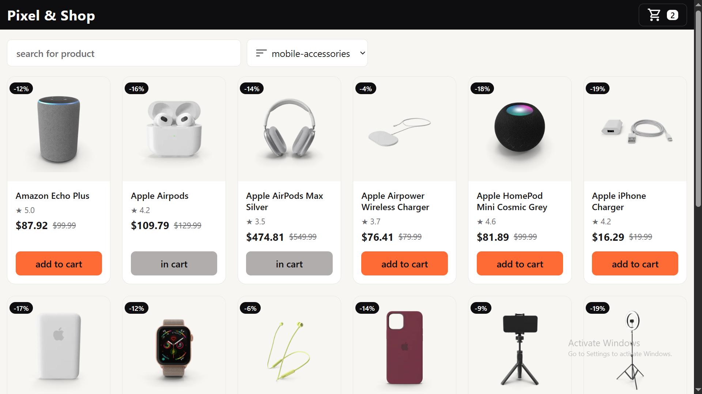

# Pixel & Shop — Tech Store

A responsive e-commerce storefront built with React and Redux Toolkit.
Products are fetched from the DummyJSON API.

**Live demo:** <[pixel-shop-storel](https://pixel-shop-store.vercel.app)>

## Features

- Browse 38 products across 4 categories: smartphones, laptops, tablets and mobile accessories
- Search by product title and filter by category
- Product page with its own route (`/product/:id`) that handles loading, error and not-found states
- Cart in a side drawer: add and remove items, running total, item count in the header
- Cart persists across page reloads (localStorage)
- Responsive layout

## Tech stack

React, Vite, Redux Toolkit, React Router, MUI (Drawer and icons), plain CSS

## How it works

- **Products:** fetched once with `createAsyncThunk`; the store tracks `idle / loading / succeeded / failed` so the UI can show loading and error states.
- **Cart:** stores only product ids. The cart items and the total are derived from the products list, so there is a single source of truth.
- **Filters:** search and category live in the store. The visible list is derived on every render instead of being stored.
- **Persistence:** the cart ids are saved to localStorage through `store.subscribe`, and only when they actually change.

## Run locally

    git clone <https://github.com/ALI-cmd-front-developer/pixel-shop-store.git>
    cd <pixel-shop>
    npm install
    npm run dev

## Possible improvements

- Brand and price filters
- Quantity per cart item
- Tests
